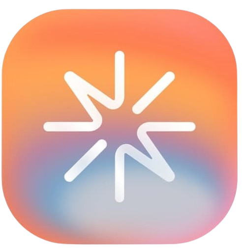
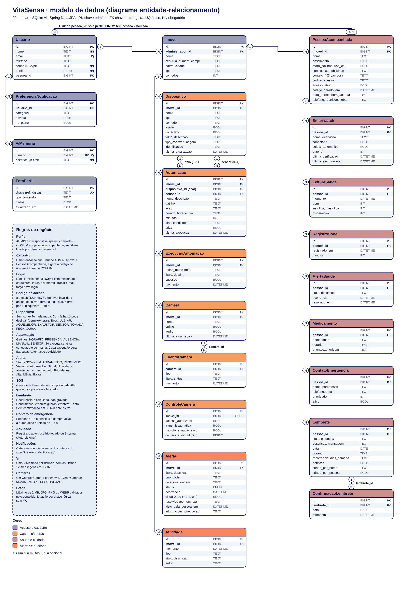
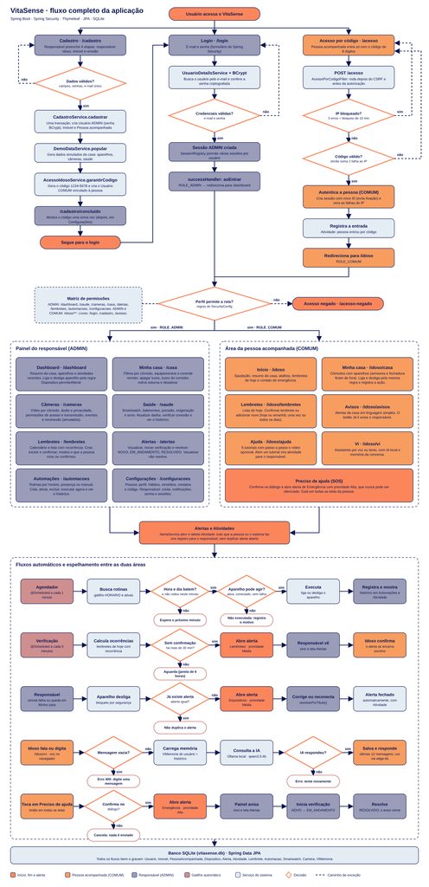

# VitaSense

<p align="center">
  
</p>

<p align="center">
  <strong>Tecnologia que aproxima, cuidado que transforma.</strong><br>
  Plataforma web de cuidado e monitoramento inteligente para pessoas idosas.
</p>

<p align="center">
  
  
  
  
</p>

## Sobre o projeto

O **VitaSense** é uma aplicação web desenvolvida para aproximar pessoas idosas de seus responsáveis por meio de recursos de tecnologia assistiva, automação residencial e acompanhamento remoto.

A proposta é oferecer mais tranquilidade para quem acompanha e, ao mesmo tempo, preservar a autonomia, a privacidade e a liberdade de quem recebe o cuidado. A plataforma reúne informações da residência, dispositivos, câmeras, lembretes, saúde e alertas em um único ambiente.

O sistema possui duas áreas com permissões distintas:

- **Responsável (ADMIN):** configura a residência e acompanha dispositivos, câmeras, saúde, lembretes, automações e alertas.
- **Pessoa acompanhada (COMUM):** acessa uma interface simplificada, com recursos de uso cotidiano, avisos, lembretes, tutoriais e a assistente virtual Vi.

O VitaSense é um projeto acadêmico do **ExpoTech 2026.2**, desenvolvido no contexto do curso de Ciência da Computação.

## Funcionalidades

### Área do responsável — ADMIN

- **Dashboard:** visão geral da residência, dispositivos, atividades e alertas.
- **Minha casa:** organização por cômodos, consulta e controle de dispositivos.
- **Câmeras:** visualização de câmeras e configurações de áudio e privacidade (recursos simulados no escopo atual).
- **Saúde:** acompanhamento de informações e registros de saúde, incluindo dados de smartwatch e sono.
- **Lembretes:** criação, edição, recorrência e acompanhamento de confirmações.
- **Alertas e atividades:** consulta, visualização, acompanhamento e resolução de ocorrências.
- **Automações:** configuração de rotinas por horário, dias da semana ou eventos relacionados a dispositivos.
- **Configurações:** gerenciamento dos dados do responsável, da pessoa acompanhada, medicamentos, hábitos, informações importantes, contatos de emergência, notificações e segurança.
- **Acesso por código:** geração, renovação e desativação do código utilizado pela pessoa acompanhada.

### Área da pessoa acompanhada — COMUM

- **Início:** resumo da casa, atalhos, lembretes e acesso à Vi.
- **Minha casa:** consulta dos cômodos e controle dos aparelhos permitidos.
- **Lembretes:** visualização dos compromissos, confirmação e criação de novos lembretes.
- **Avisos:** consulta de avisos da residência em linguagem simplificada e confirmação de leitura.
- **Ajuda:** tutoriais passo a passo para utilizar os recursos do sistema.
- **Vi:** assistente virtual para conversas por texto e voz.
- **Preciso de ajuda:** acionamento de um alerta de emergência para o responsável.

### Recursos compartilhados e automáticos

- Espelhamento das ações da pessoa acompanhada no painel do responsável.
- Registro de atividades com identificação do autor ou do sistema.
- Alertas para situações que exigem atenção.
- Verificação agendada de automações e lembretes pendentes.
- Controle de acesso por perfil e proteção de senhas com BCrypt.

> **Observação:** o VitaSense é um protótipo acadêmico. Integrações de dispositivos, câmeras e dados de saúde podem utilizar informações simuladas, conforme indicado nas telas e nos serviços. O sistema não substitui acompanhamento profissional, serviços de emergência ou dispositivos médicos certificados.

## A assistente virtual Vi

A **Vi** é a assistente virtual integrada à área da pessoa acompanhada. Seu objetivo é oferecer companhia, responder dúvidas gerais e orientar o uso do VitaSense com uma comunicação simples, acolhedora e respeitosa.

### Como a Vi gera respostas

1. A pessoa envia uma mensagem pela interface de conversa.
2. O navegador envia o conteúdo para o endpoint `POST /idoso/vi/conversar`.
3. O `ViController` identifica o usuário autenticado e recupera seu histórico salvo na tabela `ViMemoria`.
4. O `ViService` monta as mensagens com as instruções de personalidade da Vi e o histórico recente.
5. A aplicação envia uma requisição para a API local do **Ollama**, utilizando o modelo `qwen3.5:4b`.
6. O Ollama processa o contexto e devolve a resposta.
7. A resposta é adicionada ao histórico, limitado às 12 mensagens mais recentes, e salva no banco de dados.
8. O navegador apresenta a resposta na conversa.

A memória implementada é um histórico recente por usuário, armazenado em JSON na tabela `ViMemoria`. Ela não representa uma memória ilimitada nem garante que a assistente retenha informações fora desse histórico.

### Como funciona a voz

A experiência de voz combina recursos do navegador e geração de áudio no servidor:

- **Entrada por voz:** utiliza a Web Speech API (`SpeechRecognition` ou `webkitSpeechRecognition`) para reconhecer a fala em português brasileiro e preencher o campo de mensagem.
- **Resposta falada:** o endpoint `POST /idoso/vi/voz` executa o pacote Python `edge-tts` e gera um arquivo MP3 com a voz neural `pt-BR-FranciscaNeural`.
- **Reprodução:** o navegador recebe o áudio e o reproduz, permitindo também repetir ou interromper a fala.

O reconhecimento de voz depende do suporte do navegador e da permissão de microfone. A geração de áudio depende do Python, do pacote `edge-tts` e de conexão com a internet.

## Tecnologias utilizadas

| Tecnologia | Aplicação |
|---|---|
| Java 17 | Linguagem principal do backend |
| Spring Boot 3.3.5 | Estrutura da aplicação web |
| Spring MVC | Controllers e rotas HTTP |
| Spring Security | Autenticação, autorização e gerenciamento de sessões |
| Spring Data JPA / Hibernate | Persistência e mapeamento objeto-relacional |
| SQLite | Banco de dados relacional |
| Thymeleaf | Renderização das páginas HTML |
| HTML, CSS e JavaScript | Interface e interações no navegador |
| Maven | Gerenciamento de dependências e execução |
| BCrypt | Criptografia das senhas |
| Ollama + Qwen 3.5 4B | Processamento local das conversas da Vi |
| Python + edge-tts | Geração de áudio da Vi |
| Web Speech API | Reconhecimento de fala no navegador |

## Arquitetura e organização do código

O projeto segue uma organização em camadas, separando a apresentação, o controle das requisições, as regras de negócio e a persistência.

```text
src/
├── main/
│   ├── java/br/vitasense/
│   │   ├── config/        # Segurança, filtros, inicialização e agendamentos
│   │   ├── controller/   # Rotas e tratamento das requisições
│   │   ├── dto/           # Objetos de transferência e formulários
│   │   ├── model/         # Entidades persistidas no banco
│   │   ├── repository/    # Consultas e acesso aos dados via JPA
│   │   ├── service/       # Regras de negócio e integrações
│   │   ├── util/          # Funções utilitárias
│   │   └── VitaSenseApplication.java
│   └── resources/
│       ├── static/
│       │   ├── css/       # Folhas de estilo
│       │   ├── img/       # Imagens e logotipos
│       │   ├── js/        # Scripts do navegador
│       │   └── video/     # Vídeos de tutoriais
│       ├── templates/     # Páginas Thymeleaf e fragments
│       └── application.properties
└── test/
    └── java/br/vitasense/ # Testes automatizados
```

### Responsabilidade de cada camada

- **Model:** representa as entidades e concentra regras próprias do domínio quando aplicável.
- **Repository:** abstrai as operações de consulta e gravação no SQLite.
- **Service:** executa regras de negócio, coordena repositórios e integrações.
- **Controller:** recebe as requisições, valida entradas e direciona o fluxo para os serviços.
- **Config:** centraliza segurança, filtros, inicialização de dados, sessões e tarefas agendadas.
- **DTO:** transporta dados entre formulários, controllers e serviços sem expor diretamente as entidades.

O `ContextoUsuario` resolve o usuário autenticado e o contexto da residência e da pessoa acompanhada. O `SecurityConfig` centraliza a matriz de permissões. Assim, as regras de autorização não ficam espalhadas pelos controllers.

## Modelagem de dados — Diagrama Entidade-Relacionamento (DER)

O banco de dados utiliza SQLite e é mapeado por entidades JPA. O modelo apresentado possui **22 tabelas**, organizadas em quatro grupos funcionais:

- **Acesso e cadastro:** usuários, imóveis, pessoas acompanhadas, preferências de notificação, fotos e memória da Vi.
- **Casa e câmeras:** dispositivos, automações, execuções de automação, câmeras, eventos e controles de câmera.
- **Saúde e cuidado:** smartwatch, leituras de saúde, registros de sono, medicamentos, contatos de emergência e lembretes.
- **Alertas e auditoria:** alertas, atividades e confirmações de lembretes.

O diagrama abaixo apresenta as entidades, os principais atributos, as chaves primárias (PK), as chaves estrangeiras (FK) e as cardinalidades dos relacionamentos.

<p align="center">
  
</p>

**Regras importantes do modelo:**

- Um usuário possui um perfil de acesso, como `ADMIN` ou `COMUM`.
- O responsável administra um imóvel, que pode estar associado à pessoa acompanhada.
- A pessoa acompanhada possui vínculo com o imóvel e concentra dados de saúde, lembretes e contatos.
- Os dispositivos pertencem a um imóvel e podem ser associados a automações.
- As automações registram suas execuções para manter o histórico.
- Câmeras possuem eventos e controles próprios.
- A Vi mantém um histórico de conversa associado ao usuário.
- Alertas e atividades registram ocorrências e ações relevantes do sistema.

As cardinalidades indicadas no DER representam os relacionamentos previstos no modelo. A implementação efetiva das restrições deve ser conferida nas entidades e no esquema gerado pelo Hibernate.

## Fluxograma — fluxo completo da aplicação

O fluxograma apresenta o percurso desde a entrada no VitaSense até a utilização das áreas do responsável e da pessoa acompanhada. Também representa os principais processos automáticos, decisões de segurança, alertas, rotinas e comunicação entre as duas áreas.

<p align="center">
  
</p>

### Resumo do fluxo

1. **Entrada e cadastro:** o responsável realiza o cadastro da conta, da pessoa acompanhada e do imóvel. O sistema valida os dados e prepara os registros iniciais.
2. **Autenticação:** o responsável entra com e-mail e senha. A pessoa acompanhada utiliza o código de acesso de oito dígitos.
3. **Autorização:** o Spring Security verifica o perfil e direciona cada usuário para sua área.
4. **Uso das funcionalidades:** cada perfil acessa somente os recursos permitidos pela matriz de permissões.
5. **Registro e espelhamento:** ações relevantes são registradas em atividades e, quando aplicável, refletidas na outra área.
6. **Automações e verificações:** tarefas agendadas verificam rotinas, ocorrências e lembretes pendentes.
7. **Alertas:** quando uma condição exige atenção, o sistema abre ou atualiza um alerta para acompanhamento e resolução.

## Segurança e controle de acesso

A segurança é centralizada em `config/SecurityConfig` e complementada por filtros e serviços específicos.

| Recurso | Comportamento |
|---|---|
| Responsável | Autenticação por e-mail e senha |
| Pessoa acompanhada | Autenticação por código de oito dígitos |
| Senhas | Armazenadas com BCrypt |
| Perfil ADMIN | Acesso ao painel do responsável |
| Perfil COMUM | Acesso à área da pessoa acompanhada |
| Tentativas de código | Cinco erros por IP bloqueiam novas tentativas por 10 minutos |
| Sessões | Gerenciamento pelo Spring Security e `SessionRegistry` |
| Código de acesso | Pode ser renovado ou desativado pelo responsável |
| CSRF | Proteção habilitada pelo Spring Security |

O código de acesso é individual e pode ser invalidado por renovação ou desativação. O fluxo de acesso por código é implementado pelo `AcessoPorCodigoFilter` e pelo `AcessoIdosoService`.

## Automações e tarefas agendadas

O agendador do Spring é habilitado por `AgendamentoConfig`, que ativa o processamento de métodos anotados com `@Scheduled`.

Entre os processos implementados estão:

- Verificação periódica das automações configuradas.
- Execução de rotinas conforme horário e condições cadastradas.
- Registro das execuções em `ExecucaoAutomacao`.
- Verificação de lembretes que não foram confirmados dentro do prazo.
- Abertura e resolução de alertas conforme as regras do sistema.

As ações executadas são registradas para permitir consulta posterior pelo responsável.

## Como executar o projeto

### Pré-requisitos

Instale os seguintes componentes:

- **JDK 17** ou superior.
- **Maven** (ou utilize o Maven Wrapper, caso esteja disponível na sua cópia).
- **Python 3** e `pip`, para a geração de voz da Vi.
- **Ollama**, para executar o modelo de linguagem localmente.

### 1. Clonar o repositório

```bash
git clone https://github.com/aisacostaa/VitaSense.git
cd VitaSense
```

### 2. Preparar a inteligência artificial da Vi

Com o Ollama instalado e em execução, baixe o modelo utilizado pelo projeto:

```bash
ollama pull qwen3.5:4b
```

O serviço da Vi utiliza a API local do Ollama em:

```text
http://localhost:11434
```

O modelo configurado atualmente está definido em `ViService`.

### 3. Instalar a dependência de voz

Instale o pacote Python responsável por gerar o áudio:

```bash
python -m pip install edge-tts
```

O backend executa o pacote por meio do comando `python -m edge_tts`. Em ambientes nos quais o executável Python possui outro nome, ajuste o comando no `ViController`.

### 4. Configurar o banco de dados

O projeto utiliza SQLite. Por padrão, o arquivo `vitasense.db` é criado na raiz de execução da aplicação.

As configurações principais estão em:

```text
src/main/resources/application.properties
```

Configuração atual:

```properties
spring.datasource.url=jdbc:sqlite:vitasense.db
spring.datasource.driver-class-name=org.sqlite.JDBC
spring.jpa.database-platform=org.hibernate.community.dialect.SQLiteDialect
spring.jpa.hibernate.ddl-auto=update
```

O Hibernate atualiza a estrutura do banco automaticamente (`update`). Para preservar os dados, não exclua o arquivo `vitasense.db` durante a execução normal.

### 5. Executar a aplicação

Na raiz do projeto, execute:

```bash
mvn spring-boot:run
```

A aplicação ficará disponível em:

```text
http://localhost:8080
```

Para gerar o pacote:

```bash
mvn clean package
```

Para executar o JAR gerado:

```bash
java -jar target/vitasense-0.1.0.jar
```

### 6. Acessar o ambiente de demonstração

Com a configuração padrão `vitasense.seed=true`, o inicializador cria dados demonstrativos na primeira execução.

**Responsável — ADMIN**

```text
E-mail: admin@vitasense.com
Senha: admin123
```

A pessoa acompanhada utiliza o código de acesso gerado no cadastro e exibido na tela de conclusão. Em ambiente de demonstração, consulte essa tela ou as configurações do responsável para obter o código vigente.

> **Atenção:** as credenciais acima são exclusivamente para demonstração e desenvolvimento. Altere ou desative o seed antes de disponibilizar o sistema em qualquer ambiente compartilhado ou de produção.

Para desativar a criação automática dos dados demonstrativos, altere em `application.properties`:

```properties
vitasense.seed=false
```

## Testes

Os testes automatizados ficam em `src/test/java/br/vitasense/` e cobrem regras de negócio e comportamentos importantes, como:

- Regras de dispositivos.
- Regras e ciclo de vida de alertas.
- Recorrência e confirmação de lembretes.
- Automações.
- Acesso da pessoa acompanhada por código.
- Serviços da área da pessoa acompanhada.
- Ajuda e configurações.

Para executar todos os testes:

```bash
mvn test
```

## Entidades principais

O modelo é composto, entre outras, pelas seguintes entidades:

| Grupo | Entidades |
|---|---|
| Acesso e cadastro | `Usuario`, `Imovel`, `PessoaAcompanhada`, `PreferenciaNotificacao`, `FotoPerfil`, `ViMemoria` |
| Casa e automação | `Dispositivo`, `Automacao`, `ExecucaoAutomacao`, `Camera`, `EventoCamera`, `ControleCamera` |
| Saúde e cuidado | `Smartwatch`, `LeituraSaude`, `RegistroSono`, `Medicamento`, `ContatoEmergencia`, `Lembrete`, `ConfirmacaoLembrete` |
| Alertas e auditoria | `Alerta`, `AlertaSaude`, `Atividade` |

A lista e os relacionamentos completos estão representados no [diagrama entidade-relacionamento](docs/diagramas/modelo-entidade-relacionamento.png).

## Próximas evoluções

O projeto pode evoluir com integrações reais de dispositivos IoT, sensores e câmeras, ampliação das fontes de dados de saúde, aprimoramento das notificações e evolução das capacidades da Vi. Essas melhorias devem preservar os recursos já implementados e respeitar os princípios de acessibilidade, autonomia e privacidade.

## Equipe e contribuição

Projeto desenvolvido para o **ExpoTech 2026.2**.

Contribuições, sugestões e identificação de problemas são bem-vindas por meio das issues e pull requests do repositório.

---

<p align="center">
  <strong>VitaSense — Tecnologia que aproxima, cuidado que transforma.</strong>
</p>
